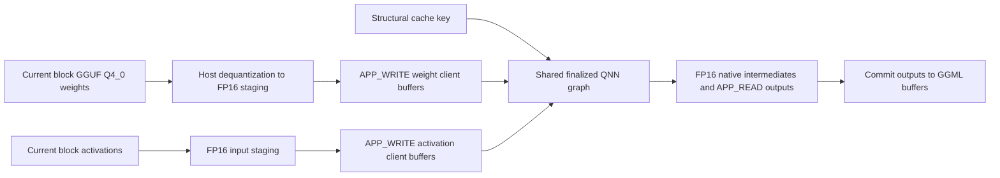
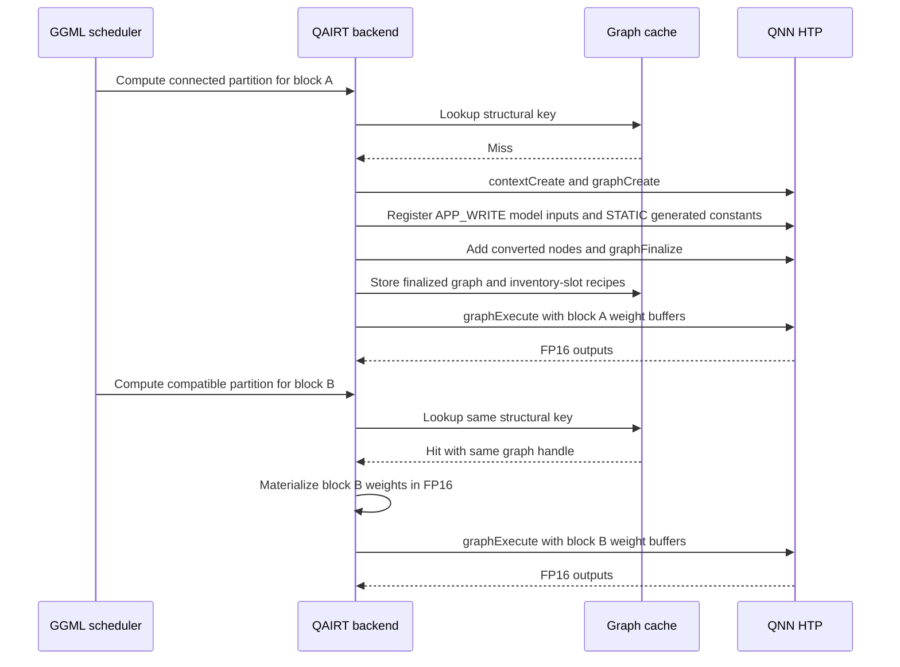

# QAIRT APP_WRITE weights and graph reuse experiments

Date: November 20, 2026. SDK: QAIRT 2.52.0.261104, QNN HTP V73, Windows ARM64. Repository branch: `Add-ggml-qairt-backedn`; baseline commit: `fd7250711`. Experimental changes are uncommitted.

> November 23, 2026: cross-weight graph sharing was removed. APP_WRITE remains supported, with graph cache entries specific to weight allocations. Ordinary graphs now share a context by default. The graph-sharing results below are historical experiments.

## Outcome and scope

The native W4FP16 path cannot use APP_WRITE weights with this SDK. A direct QNN test registers the BW_FLOAT_BLOCK weight as APP_WRITE but fails at `backendValidateOpConfig` with code 3110 and `Received non-Static for tensor`. HTP MatMul validation explicitly calls `CHECK_IS_STATIC_TENSOR(INPUT(opConfig,1))` for BW_FLOAT_BLOCK. This is an SDK constraint rather than a cache-key constraint.

FP16 graph sharing completed the full-model run with 10 successful compilations, 672 cache hits, 682 executions and zero finalization failures. All 20 teacher-forced output tokens matched the CPU reference, and reset reproduced both prefill logits exactly. Total QNN finalization time was 8.605773 seconds; full validation-fixture time was 741.649 seconds. Strict model accuracy still fails and is itemized below.

Both full-model phases therefore use FP16 weights and FP16 activations. They do not qualify native W4 graph sharing. Defaults retain STATIC weights and optional native W4FP16. Combining native W4FP16 with APP_WRITE returns an explicit configuration error.

## Configuration

Capture configuration before backend discovery and model loading:

```powershell
$env:GGML_QAIRT_DEVICE = 'HTP'
$env:GGML_QAIRT_LIBRARY_DIR = 'C:\Qualcomm\AIStack\QAIRT\2.52.0.261104\lib\aarch64-windows-msvc'
$env:ADSP_LIBRARY_PATH = 'C:\Qualcomm\AIStack\QAIRT\2.52.0.261104\lib\hexagon-v73\unsigned'
$env:GGML_QAIRT_W4FP16 = '0'
$env:GGML_QAIRT_APP_WRITE_WEIGHTS = '1'
$env:GGML_QAIRT_DIAGNOSTICS = '1'
```

Both new flags accept only `0` or `1` and default to `0`. Graph sharing requires APP_WRITE weights. Configuration remains immutable after process capture.

## Phase 1: change the weight tensor role

Model weights become `QNN_TENSOR_TYPE_APP_WRITE`, `QNN_DATATYPE_FLOAT_16` inputs. Registration supplies no data. Execution binds current model weights through `Qnn_Tensor_t.v1.clientBuf` along with normal activation inputs. Generated graph constants, including normalization gamma/beta and scalar factors, remain STATIC.

The cache still includes each model weight's allocation identity, generation and offset. This isolates the tensor-role change from cross-block sharing. The full-model run fails during prefill after 24 successful graph compilations and 26 executions. `graphFinalize` returns 6020 through the transport layer. Its diagnostics include `Failed to initialize graph memory`. This run does not establish a fix for the earlier W4 STATIC allocation failure.

The prior W4 STATIC 4 GiB run failed during first decode with graph-finalization error 1002 and a weights-buffer mapping error. The new FP16 APP_WRITE phase fails earlier with 6020. These are different datatype and tensor-role configurations; they do not prove the same underlying resource limit.

## Phase 2: share compatible graphs across blocks

Model weights remain FP16 APP_WRITE inputs. The cache removes model-weight allocation identity, generation and offset. It preserves GGML operation and source type, dimensions, strides, view offsets, parameters, source-slot topology and view-parent topology. Different shape profiles or operation sequences still get different graphs. Reuse is structural, not based on transformer block names.

Prepared partitions store inventory slots and QNN tensor IDs, not GGML model tensor pointers. Every execution rebuilds the current inventory, materializes that block's weights and binds fresh input buffers. Changing weights therefore changes outputs without graph compilation. Quantization metadata is absent from these FP16 inputs, so differing Q4_0 block scales cannot be accidentally reused as compiled QNN metadata.





The host staging vectors survive until synchronous `graphExecute` returns. This experiment does not cache FP16 dequantized weights, register shared memory, promise zero-copy execution or reuse W4 tensor metadata. Host conversion and execution-time transfer costs remain performance work.

## Measurements

Same command for both phases:

```powershell
& 'C:\Github\qairt-qwen3-m2-arm64\bin\Release\test-qairt-model.exe' `
    'C:\Models\Qwen3-1.7B-Q4_0.gguf' --fused --fp16-reference `
    --offload-last all --decode-steps 20 `
    --prompt 'Explain how rain forms. Write three complete sentences.'
```

The model has 28 transformer blocks, numbered 0-27. All blocks use the existing hybrid placement, with the three Q4_1 FFN-down projections in blocks 0-2 and embedding/LM head remaining CPU. The fixture uses a 23-token prefill, 20 teacher-forced decode steps and a cleared-KV reset replay. It compares against the existing FP16-emulated CPU reference, with unchanged accuracy limits.

| Phase | Status | Successful compilations | Failed finalizations | Cache hits | Executions | Finalization time (s) | Process time (s) |
|---|---|---:|---:|---:|---:|---:|---:|
| 1: FP16 APP_WRITE, block-specific keys | completed | 24 | 1 | 2 | 26 | 30.723292 | 85.684 |
| 2: FP16 APP_WRITE, structural sharing | completed | 10 | 0 | 672 | 682 | 8.605773 | 741.649 |

Graph compilation is lazy at first use of a cache key. Timings measure successful and failed attempts that reach finalization. Preparation includes lowering, tensor/node registration and finalization; finalization time is a subset. Cache hits perform no finalization. The existing logical cache budgets remain 4 GiB of retained static payload/RoPE tables and 512 graph entries; transient APP_WRITE weight staging is not charged as retained STATIC payload. These budgets do not measure all driver/device allocations.

### Phase 2 frame results

| Frame | New graphs | Hits | Executions | Local NMSE | Maximum logit error | KL | Greedy CPU/HTP |
|---|---:|---:|---:|---:|---:|---:|---|
| prefill | 5 | 26 | 31 | 6.80060526e-10 | 0.365947962 | 1.03517441e-09 | 59039/59039 |
| decode0 | 5 | 26 | 31 | 6.23603073e-10 | 0.308309555 | 1.13167623e-07 | 7586/7586 |
| decode1 | 0 | 31 | 31 | 2.07615521e-09 | 0.31393528 | 4.41294083e-11 | 979/979 |
| decode2 | 0 | 31 | 31 | 2.11494536e-09 | 0.298089266 | 5.14099804e-06 | 3015/3015 |
| decode3 | 0 | 31 | 31 | 2.72420034e-09 | 0.355337143 | 0.000998752164 | 37652/37652 |
| decode4 | 0 | 31 | 31 | 8.82395592e-09 | 0.288843632 | 2.85319418e-11 | 304/304 |
| decode5 | 0 | 31 | 31 | 1.98484056e-09 | 0.318614483 | 1.90872766e-06 | 279/279 |
| decode6 | 0 | 31 | 31 | 2.00092651e-09 | 0.353425026 | 6.08090771e-05 | 16566/16566 |
| decode7 | 0 | 31 | 31 | 5.0411196e-09 | 0.315301895 | 0.00012018305 | 9756/9756 |
| decode8 | 0 | 31 | 31 | 2.92638884e-09 | 0.274237394 | 1.11068336e-08 | 4280/4280 |
| decode9 | 0 | 31 | 31 | 3.68829877e-09 | 0.406293869 | 3.72028058e-09 | 1119/1119 |
| decode10 | 0 | 31 | 31 | 1.55940828e-09 | 0.298798203 | 0.000346662605 | 13673/13673 |
| decode11 | 0 | 31 | 31 | 5.7944794e-09 | 0.318247795 | 4.75274425e-06 | 6973/6973 |
| decode12 | 0 | 31 | 31 | 2.62498627e-09 | 0.3121171 | 6.10183194e-10 | 89492/89492 |
| decode13 | 0 | 31 | 31 | 5.89243274e-09 | 0.427286625 | 0.00659981862 | 13/13 |
| decode14 | 0 | 31 | 31 | 4.89700002e-09 | 0.425474167 | 5.02187352e-09 | 4220/4220 |
| decode15 | 0 | 31 | 31 | 5.80955843e-09 | 0.445525169 | 1.03497214e-10 | 6973/6973 |
| decode16 | 0 | 31 | 31 | 2.88357806e-09 | 0.313105583 | 1.35440577e-11 | 89492/89492 |
| decode17 | 0 | 31 | 31 | 2.57441544e-09 | 0.368835926 | 0.00163475668 | 9567/9567 |
| decode18 | 0 | 31 | 31 | 2.40085165e-09 | 0.355718613 | 0.000664834327 | 2163/2163 |
| decode19 | 0 | 31 | 31 | 2.29051082e-09 | 0.427785873 | 0.000396733821 | 18730/18730 |
| reset | 0 | 31 | 31 | 6.80060526e-10 | 0.365947962 | 1.03517441e-09 | 59039/59039 |

Status: completed.

Generated-token comparison: `{"tokens": 20, "disagreements": 0, "identical": 1}`.

cpu_reference:

> Rain forms when water vapor in the atmosphere condenses into tiny droplets. These droplets gather around

hybrid:

> Rain forms when water vapor in the atmosphere condenses into tiny droplets. These droplets gather around

Final test summary: `{"CPU_control": 0, "layers": 28, "selected": 27, "prefill": 23, "tail": 0, "decode": 20, "disagreements": 0, "failures": 1948}`. Assertions by expression: `{"passed": 1880, "found != actual.tensors.end()": 66, "m.maximum <= 0.75 && m.kl <= 0.001": 2}`.

## Remaining accuracy and qualification limits

No local projection comparison failed the unchanged NMSE <= 1e-5 limit. Worst local NMSE was 8.82395592e-9. Maximum output-logit absolute error was 0.445525169, below the 0.75 limit. Two frames failed KL <= 0.001: decode13 was 0.00659981862 and decode17 was 0.00163475668. Greedy choices still matched in those frames.

The complete capture records 1,948 failed assertions: 1,880 intermediate/checkpoint comparisons, 66 missing-observation checks and two output-logit KL checks. Checkpoint comparisons require maximum absolute error <= 0.75 and relative error <= 0.02, or KL <= 0.001 for logits. Numerical gates were not changed. Graph reuse success is therefore separate from strict full-model accuracy qualification.

The 20-token response is teacher-forced: both executions receive the CPU-selected next token. It is not an independent long-form generation or perplexity qualification. Runtime includes CPU reference execution, local comparisons and diagnostic collection; it is not a clean inference benchmark. The original failed STATIC W4 run uses another weight datatype, so its timing is not a controlled measure of the benefit of graph sharing alone.

## Verification and evidence

The direct FP16 STATIC-versus-APP_WRITE fixture matched all 128 output values exactly for K=128, N=64, M=2: NMSE=0 and maximum absolute error=0. The backend A/B/A/mutation fixture checks independent weight values and updated Q4_0 scales after host conversion. Block-specific keys compile three graphs for four executions; structural sharing compiles one and records three hits. The complete ARM64 Release build succeeded, and all 22 QAIRT CTests passed in 29.52 seconds, including both distinct-allocation A/B/A/mutation configurations, the direct FP16 comparison and existing STATIC/native W4 tests. The full-model accuracy fixture is separate and exits 1.

Structured captures parse stdout and stderr separately and retain metrics, assertion counts and relevant errors:

- `QAIRT_APP_WRITE_phase1_validation.json`
- `QAIRT_APP_WRITE_phase2_validation.json`

Reproduce the native W4 APP_WRITE rejection with `test-qairt-quantized-weights.exe --dynamic-weights --tensor-v1 --sign-extend --k 128 --n 64 --m 2 --runs 2`. Reproduce the independent FP16 comparison with `test-qairt-quantized-weights.exe --fp16-only --dynamic-fp16 --tensor-v1 --k 128 --n 64 --m 2 --runs 2`, with APP_WRITE/sharing runtime flags cleared for this direct fixture.

Implementation:

- `ggml/src/ggml-qairt/qairt-target.{h,cpp}`: flags, capture and incompatible-mode validation.
- `ggml/src/ggml-qairt/qairt-partition.cpp`: APP_WRITE model inputs and structural cache identity.
- Existing `qairt-graph.cpp`: registration, synchronous execution and checked client-buffer binding reused unchanged.
- `tests/test-qairt-fp16.cpp`: A/B/A/mutation checks and configuration tests.
- `tests/test-qairt-quantized-weights.cpp`: independent FP16 STATIC/APP_WRITE comparison.

Local SDK reference: `C:\QAIRT code copy\QAISW\FirstParty\QNN\HTP\API\OpDef\HtpOpDefSupplementFp16.xml`, MatMul constraint near line 5867. QNN execution contract: SDK `include/QNN/QnnGraph.h`, synchronous `QnnGraph_execute` declaration. The graph API takes graph-input descriptors; changing a client buffer does not itself authorize changing compiled quantization metadata.
