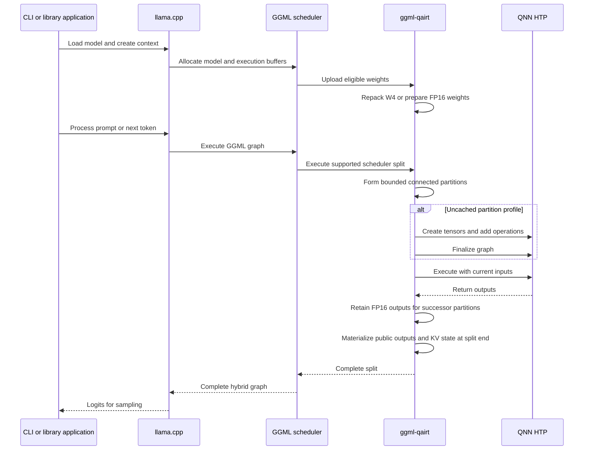

# Running ggml-qairt through llama.cpp

The Windows ARM64 backend is usable through ordinary llama.cpp library calls and `llama-cli`. The target for this checkpoint is `C:\Models\Qwen3-0.6B-Q4_0.gguf`, with all 28 transformer blocks eligible for hybrid execution. Supported operations run on HTP; unsupported operations use the normal CPU backend.

No evaluation callback, test-specific buffer override, or context binary is required. QNN graphs are prepared and finalized at runtime.

## Build

The existing ARM64 build is `C:\Github\qairt-qwen3-m2-arm64`. To build the application and the public-library example:

```powershell
cmake --build C:\Github\qairt-qwen3-m2-arm64 --config Release --target llama-cli llama-simple -j 8
```

For a new build directory:

```powershell
cmake -S C:\Github\llama.cpp -B C:\Github\qairt-native-arm64 -G "Visual Studio 17 2022" -A ARM64 -DGGML_QAIRT=ON -DQAIRT_SDK_ROOT=C:\Qualcomm\AIStack\QAIRT\2.52.0.261104 -DBUILD_SHARED_LIBS=ON -DGGML_OPENMP=OFF -DLLAMA_USE_PREBUILT_UI=OFF -DLLAMA_OPENSSL=OFF
cmake --build C:\Github\qairt-native-arm64 --config Release --target llama-cli llama-simple -j 8
```

Keep the generated llama/GGML DLLs beside the executable. QNN DLLs come from the SDK directory configured below. If using `GGML_BACKEND_DL=ON`, also keep `ggml-qairt.dll` discoverable by GGML's backend loader.

## Runtime environment

Set these before starting the application. QAIRT captures configuration once per process.

```powershell
$bin = 'C:\Github\qairt-qwen3-m2-arm64\bin\Release'
$sdk = 'C:\Qualcomm\AIStack\QAIRT\2.52.0.261104'

$env:GGML_QAIRT_DEVICE = 'HTP'
$env:GGML_QAIRT_LIBRARY_DIR = "$sdk\lib\aarch64-windows-msvc"
$env:ADSP_LIBRARY_PATH = "$sdk\lib\hexagon-v73\unsigned"
$env:PATH = "$env:GGML_QAIRT_LIBRARY_DIR;$bin;$env:PATH"

$env:GGML_QAIRT_W4FP16 = '1'
$env:GGML_QAIRT_SHARED_CONTEXT = '1'
$env:GGML_QAIRT_APP_WRITE_WEIGHTS = '0'
$env:GGML_QAIRT_SHARE_WEIGHT_GRAPHS = '0'
$env:GGML_QAIRT_DIAGNOSTICS = '0'
$env:GGML_QAIRT_PROFILE = '0'
$env:GGML_QAIRT_VALIDATE = '0'
```

The environment above explicitly enables W4FP16 and shared contexts. Both are disabled by default in this runtime-preparation branch.

| Variable | Default | Purpose |
| --- | --- | --- |
| `GGML_QAIRT_DEVICE` | `HTP` | QNN target selection; HTP is implemented, GPU/CPU targets remain disabled |
| `GGML_QAIRT_LIBRARY_DIR` | Unset; required | Absolute directory containing the QNN provider DLL |
| `GGML_QAIRT_W4FP16` | `0` | Repack eligible Q4_0/Q4_1 projection weights during upload; keep FP16 activations |
| `GGML_QAIRT_SHARED_CONTEXT` | `0` | Keep cached graphs in one runtime-created QNN context |
| `GGML_QAIRT_APP_WRITE_WEIGHTS` | `0` | Experimental FP16 weight inputs; incompatible with W4FP16 |
| `GGML_QAIRT_SHARE_WEIGHT_GRAPHS` | `0` | Experimental structural sharing; requires APP_WRITE, disabled for this run |
| `GGML_QAIRT_DIAGNOSTICS` | `0` | Optional backend diagnostic detail |
| `GGML_QAIRT_PROFILE` | `0` | Optional basic QNN profiling |
| `GGML_QAIRT_VALIDATE` | `0` | Full numerical and untouched-KV-row scans; exports all intermediates for validation |

The standard QNN warning logger still runs with diagnostics and profiling disabled. The removed memory-pressure instrumentation is not present.

## CLI query

After setting the environment:

```powershell
& "$bin\llama-cli.exe" --list-devices

& "$bin\llama-cli.exe" `
  -m 'C:\Models\Qwen3-0.6B-Q4_0.gguf' `
  --device QAIRT0 -ngl 29 --fit off `
  -c 1024 -b 128 -ub 128 -ctk f16 -ctv f16 -fa off `
  --warmup-batch-size 27 --single-turn --reasoning off --simple-io --color off `
  --temp 0 -n 20 `
  -p 'What is 17 plus 25? Answer only the number.'
```

`-ngl 29` requests all 28 transformer blocks and the output layer. Individual unsupported operations still fall back to CPU. `--fit off` avoids automatic fitting because QAIRT does not currently report available device memory. F16 KV storage and the shown context/batch sizes select the tested execution profile.

Use `--device none -ngl 0` for a CPU comparison. `--single-turn` performs one query and exits; omit it for interactive use. Qwen reasoning is disabled here so the response fits the requested 20-token generation budget.

Changing prompt length, microbatch size, attention mode or KV shape can require additional QNN graphs. Compilation and finalization happen on first execution of each uncached profile. The initial application setup can itself execute small probe graphs even with `--no-warmup`.

## Initialization preparation for the selected query shape

`--warmup-batch-size 27` prepares the current query's 27-token prefill and its one-token decode during application initialization. The command above enables this setting. The count includes chat-template tokens; a different prompt length may need a different profile.

Initialization executes each representative profile once, retains finalized QNN graphs, clears warmup KV state and resets performance counters. This is an initialization warmup, including execution, rather than a compile-only QNN pass.

Library applications can include `common.h`, link `llama-common`, and call `common_warmup_profile(context, 27)` immediately after creating an empty decoder context. Check the returned boolean before accepting a query. The helper uses ordinary public llama APIs. Applications linking only llama can perform the same two batch evaluations and reset memory/performance counters themselves.

Native HTP regression: 33 graphs prepared during complete initialization; zero additional graph preparations for a matching actual prefill/decode pair. The measured backend construction/finalization time was 25.74 seconds, including 24.81 seconds in QNN graph finalization. Those totals include startup probe graphs as well as the selected profile.

CLI measurement on November 24, 2026:

| Phase | Measured result | Includes graph preparation? |
| --- | --- | --- |
| Initialization prefill, 27 tokens | 18.76 seconds | Yes; also executes the representative batch |
| Initialization decode, 1 token | 10.74 seconds | Yes; also executes the representative token |
| Actual query prefill | 19.86 tokens/s | Selected profile already prepared |
| Actual query decode | 0.84 tokens/s | Selected profile already prepared |

The actual query returned `17 + 25 = 42.` New prompt, sequence, output, attention/KV or attention-window shapes can still compile at runtime. The optional warmup count defaults to zero (legacy behavior), and `--no-warmup` disables profile warmup.

## Public library configuration

Set the same environment before backend discovery. Use normal public headers and APIs:

```cpp
#include "ggml-backend.h"
#include "llama.h"

ggml_backend_load_all();
llama_backend_init();

ggml_backend_dev_t qairt = ggml_backend_dev_by_name("QAIRT0");
if (!qairt) {
    // Report an unavailable QAIRT backend.
    llama_backend_free();
    return 1;
}

ggml_backend_dev_t devices[] = {qairt, nullptr};
llama_model_params model_params = llama_model_default_params();
model_params.devices = devices;
model_params.n_gpu_layers = 29;

llama_model * model = llama_model_load_from_file(
    "C:\\Models\\Qwen3-0.6B-Q4_0.gguf", model_params);
if (!model) {
    llama_backend_free();
    return 1;
}

llama_context_params context_params = llama_context_default_params();
context_params.n_ctx = 1024;
context_params.n_batch = 128;
context_params.n_ubatch = 128;
context_params.type_k = GGML_TYPE_F16;
context_params.type_v = GGML_TYPE_F16;
context_params.flash_attn_type = LLAMA_FLASH_ATTN_TYPE_DISABLED;

llama_context * context = llama_init_from_model(model, context_params);
if (!context) {
    llama_model_free(model);
    llama_backend_free();
    return 1;
}

// Tokenize a chat-formatted prompt with llama_tokenize.
// Fill a llama_batch_ext and call llama_process with LLAMA_PROCESS_TYPE_DECODE.
// Use a normal llama sampler; submit each sampled token in the next batch.

// Free any application-owned batch and sampler first.
llama_free(context);
llama_model_free(model);
llama_backend_free();
```

This is an initialization fragment inside an application function. The ordinary `examples/simple/simple.cpp` example supplies complete tokenization, batch handling and greedy generation. It uses the public library without QAIRT-specific evaluation hooks.

After setting the environment, a direct public-library query is:

```powershell
$prompt = "<|im_start|>user`nWhat is 17 plus 25? Answer only the number.<|im_end|>`n<|im_start|>assistant`n<think>`n`n</think>`n`n"
& "$bin\llama-simple.exe" -m 'C:\Models\Qwen3-0.6B-Q4_0.gguf' -ngl 29 -n 20 $prompt
```

Unlike the CLI, `llama-simple` does not apply the chat template. The raw prompt above supplies Qwen's role markers and closes the empty reasoning section.

## Execution and ownership



QAIRT advertises support for its own buffer type. Ordinary CPU buffers use scheduler transfer paths, preventing CPU input and attention-mask preparation from being assigned to QAIRT merely because its memory is host accessible. Legitimate host inputs remain readable for backend staging.

A scheduler split can exceed 128 GGML nodes. QAIRT forms smaller connected partitions, bounded by 128 GGML nodes, a 256 MiB staging budget, and an estimate of the 1,024-tensor QNN graph limit. Grouped MatMul and decomposed attention receive extra tensor costs for their per-head slices, range parameters and intermediate results. Graph-owner checks still enforce actual tensor limits.

Compatible successor inputs bind retained FP16 outputs directly. Strided views use FP16 gathering; canonical F32/BF16 inputs convert when needed. Only CPU/public exits and KV/copy side effects are materialized into GGML at split completion, or before a CPU singleton. The allocation dependency hook retains readable outputs to split completion. Reused graphs receive replacement output buffers if earlier values remain live.

Export plans include live exits plus FP16 precision checkpoints around MatMul, normalization, and RoPE and their input layouts. Checkpoints preserve the accepted graph numerics; removing them failed full-logit NMSE qualification. Request observable intermediates with `ggml_set_output()`. Export plans participate in graph cache keys.

`GGML_QAIRT_VALIDATE=1` enables full numerical/KV preservation scans and all-output export. Default execution keeps API/binding metadata checks and operation-specific mask, index, and RoPE checks. RAW client-buffer binding does not prove that QNN avoids internal mapping or transfers.

Cached graphs retain their finalized QNN resources. Reuse requires matching operations, layouts, shapes, parameters and weight identities/generations. W4/FP16 STATIC weights remain owned by the QNN context. The 4 GiB logical static-cache limit is a host retention policy; it does not increase HTP address-space capacity.

## Measured native-path results (November 24, 2026)

Prompt: `What is 17 plus 25? Answer only the number.` Generation budget: 20 tokens; EOS ended the response earlier.

| Path | Response | Result | Prompt tokens/s | Decode tokens/s |
| --- | --- | --- | --- | --- |
| Cold llama-cli, QAIRT0, all 28 blocks eligible | `17 + 25 = 42.` | Exit 0; no compute errors | 1.55 | 0.48 |
| Normal llama-simple public-library example, QAIRT0 | `17 + 25 = 42.` | Exit 0; no compute errors | 1.47 | 0.84 |
| Normal llama-cli, CPU only | `17 + 25 = 42.` | Exit 0 | 28.4 | 26.7 |

CLI and simple use different context/attention settings; their timing figures are not a controlled performance comparison. Both HTP runs reported ten reused llama execution graphs. This counter belongs to llama.cpp and is not a count of QNN finalized graph-cache hits.

Focused verification: native runtime regression 105 checks, standard QAIRT hardware suite 338 checks, FP16 host suite 297 checks, M1 host suite 11 checks; all zero failures. FP16 reference self-test also passed. The registered `qairt-native-runtime-htp` CTest passed (1/1).

The grouped-MatMul regression first reproduced `register_tensor: Graph tensor limit` before the tensor-cost partition fix. Earlier large-graph and CPU-buffer regressions also failed before the native-path changes. These failures establish that the new tests cover the observed integration gaps.
## Verification and limits

- ARM64 Release builds of `llama-cli`, `llama-simple` and the focused QAIRT test succeed.
- `test-qairt --runtime-path` checks CPU-buffer ownership, a 160-Add chain and 32 dependent grouped MatMuls.
- The runtime regression checks exact outputs, including execution across partition boundaries.
- FP16 host checks and the FP16 reference self-test retain their original acceptance criteria.
- A successful query demonstrates execution and a correct answer for this prompt. Existing model/intermediate accuracy exceptions remain; this change does not qualify arbitrary prompts, model sizes or numerical precision.
- CPU fallbacks remain. This is hybrid HTP execution, not an assertion that every model operation runs on HTP.
- No context-binary generation or loading is used.
- Performance includes runtime graph preparation and is not yet optimized.

At low CLI verbosity, an embedded-server compute error can still leave a zero process exit code. Check the generated answer and any "Compute error" text. For troubleshooting, rerun with `--log-verbosity 3` to expose the QNN failure stage.
## Qualified boundary optimization benchmark

Qwen3-0.6B, all 28 blocks hybrid, ARM64 Release, eight CPU threads, 23-token prefill and 20 decode calls; matching graphs compiled during initialization. Prefill improved from 14.9711 to 110.3716 tokens/s (7.37x); decode improved from 0.6048 to 2.3504 tokens/s (3.89x). Timing includes synchronization and full-logit capture, excludes initialization and fixture I/O. These are single short-prompt runs.

All 21 full-logit frames matched the prior accepted QAIRT baseline exactly (NMSE 0 against the unchanged 1e-5 limit); all 20 greedy choices agreed. Cached graphs remained 31, with zero query preparations. QNN exports changed from 732 to 730 per forward pass because precision checkpoints remain. GGML output materializations fell from 732 to 57 per pass: 56 KV updates and the final activation.

Verification: full ARM64 Release build passed; six selected CTest suites and 20 standard F16 ADD CPU-comparison cases passed. Negative numerical tests explicitly enable validation mode.
