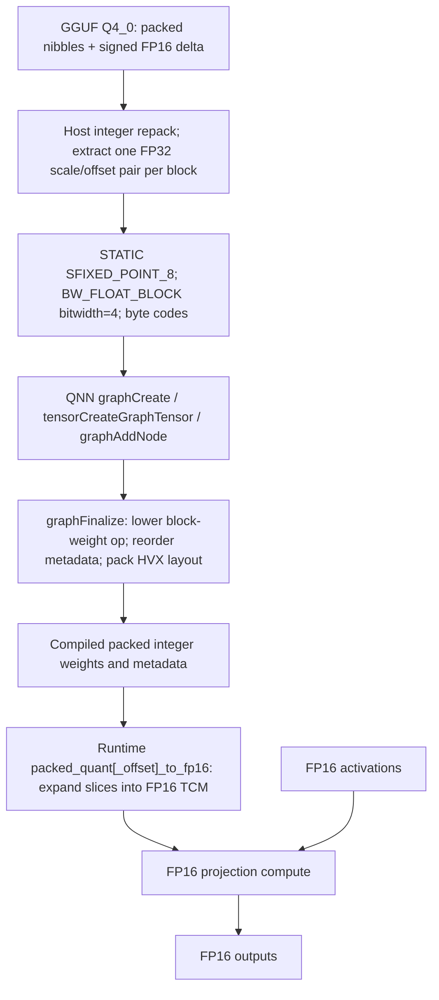

# Q4_0 weights with FP16 activations on QNN HTP

> Implementation update (November 19, 2026): the optional runtime `GGML_QAIRT_W4FP16=1` path now implements initialization repacking and native MatMul lowering. Full FP16 remains the default. See [runtime W4FP16 weights](QAIRT-w4fp16.md). The research snapshot below preserves its original measurements and conclusions.

Research date: November 19, 2026. SDK: `2.52.0.261104`. Target: Windows ARM64, HTP V73. Model: `C:\Models\Qwen3-1.7B-Q4_0.gguf`. Production baseline: `baad4b7c1` (`M2 Full FP16`) on `Add-ggml-qairt-backedn`.

## 1. Findings and scope

QNN HTP supports native block-quantized W4 weights with FP16 activations and outputs for **MatMul, FullyConnected, and eligible 1x1 Conv2d**. The supported public representation is a **STATIC SFIXED_POINT_8 byte carrier with BW_FLOAT_BLOCK encoding and bitwidth=4**. The HTP compiler packs those weights; the source implementation expands packed weights into FP16 in TCM during execution.

This avoids host floating-point dequantization of every weight. It does **not** accept the GGUF Q4_0 buffer unchanged: separate the block scales, unpack and reorder the integer codes, and provide QNN metadata. Direct packed `SFIXED_POINT_4` and `UFIXED_POINT_4` tensor registration failed on this installation.

All 48 real-model weight comparisons passed the unchanged NMSE budget of `1e-5`. The positive-scale W4 representation still fails several dense synthetic cases. Public scale/offset documentation also disagrees with observed behavior. Smaller API payloads and faster host repacking did not establish an overall performance gain: execution was slower and some FFN graphs finalized substantially slower.

This exploration adds a standalone research driver, host packing checks, three hardware smoke tests, and this report. Production backend datatypes, model placement, accuracy thresholds, and committed baseline remain unchanged. No W4 full-model qualification or production enablement is claimed.

## 2. Evidence levels

| Evidence | What it establishes | Limitation |
|---|---|---|
| Released SDK headers and HTP operation supplement | Public datatype, tensor-role, rank, block-size and architecture contracts | Header offset formula conflicts with execution |
| Local QAIRT source and operation tests | Conversion, metadata order, packing, runtime decompression and TCM implementation | Source copy is not proven identical to released binaries |
| Direct QNN graph creation/finalization/execution | Installed SDK accepts or rejects each tested configuration; measured outputs | No kernel trace or memory profiler was collected |
| Real GGUF projection comparisons | Accuracy relative to FP16-weight HTP graphs for selected matrices and inputs | Does not establish whole-model or original F32-reference accuracy |

Sources are local. No online replacement of the installed SDK contract was used.

## 3. Operation-by-operation result

| Public QNN operation | Relevant use in ggml-qairt | W4 weights + FP16 activations | Evidence and conditions |
|---|---|---|---|
| MatMul | Q/K/V/O and FFN projections | **Supported and executed** | STATIC signed byte carrier; rank-four weight; block only along K; transpose variants tested |
| FullyConnected | Alternative projection lowering | **Supported and executed** | STATIC weights `[N,K]`, block `[1,32]`; no bias in these probes |
| Conv2d | Alternative projection lowering | **Supported and executed** | 1x1 filter `[1,1,K,N]`, group=1, stride=[1,1], dilation=[1,1], zero padding in probes |
| MatMul | Dynamic QK and probability/V attention | Not an immutable-weight candidate | Both operands are activations; native W4 path requires STATIC weights. Dynamic-weight probes failed validation |
| RmsNorm / LayerNorm | Normalization and gamma/beta | No documented mixed FP16/W4 weight row | Inspected FP16 rows require FP16 numerical operands. Current learned normalization scales originate as floating-point tensors |
| ElementWiseMultiply | Learned normalization scales, attention scaling, SwiGLU | No documented FP16/W4 decoding path | FP16 operands remain FP16; existing mixed integer configurations are different activation contracts |
| ElementWiseAdd | Residual and mask addition | No documented FP16/W4 decoding path | Skip and logits/mask are activation tensors, not projection weights |
| Gather | Embedding or output-row selection | No documented Q4_0-block-to-FP16 decoding path | FP16 source/output rows use integer indices; integer Gather support does not establish W4 block dequantization |
| RotaryEmbedding | RoPE with selected cosine/sine tables | No documented mixed FP16/W4 table path | Numerical inputs/tables/output are FP16; optional position indices are INT32 |
| Sigmoid / Softmax | SiLU decomposition and attention probabilities | No learned weight operand to optimize | Keep FP16 activations |
| ScatterNd | KV updates | No learned weight operand to optimize | Keep numerical cache/update tensors FP16 and indices integer |
| Reshape / Transpose / StridedSlice / Concat | Layout and head transformations | Not a Q4_0 decoder | Shape/type support alone cannot substitute for a block-weight conversion contract |

The last rows are **documentation findings**, not new standalone mixed-weight execution tests. The driver executes the three operations that have the native mixed-weight contract. It also compares all seven Q4_0 projections in block 27, rather than treating one projection as evidence for the others.

Qwen3 has 28 transformer blocks, indexed 0-27. Its last-block projections use Q4_0. Early-block Q4_1 FFN-down weights and the tied Q6_K embedding/output require separate format work; this test does not silently reinterpret them as Q4_0.

## 4. Q4_0 storage and integer-only translation

Each Q4_0 block contains 32 values:

```text
bytes 0-1:   signed FP16 delta d
bytes 2-17:  16 packed bytes
low nibbles: values 0-15
high nibbles: values 16-31
w[j] = d * (u[j] - 8), where u[j] is an unsigned nibble in [0,15]
```

Thus each block is 18 bytes, or 0.5625 bytes per weight. The scale can be negative. In the real block-27 query matrix, 65,351 blocks have positive deltas and 65,721 have negative deltas.

A QNN tensor cannot consume this structure verbatim. Its integer payload and scale/offset array are separate. Q4_0's low-half/high-half packing also differs from consecutive-element nibble packing.

For a public-positive-scale signed W4 representation, let `s=abs(d)`:

| Q4_0 delta | Signed code q | Effective QNN offset | Reconstruction observed in this SDK |
|---|---:|---:|---|
| d > 0 | u - 8 | 0 | q * s |
| d < 0 | 7 - u | +1 | (q + 1) * s |
| d = 0 | 0 | 0; scale normalized to 1 | 0 |

For a negative delta, `(7-u+1)*abs(d) = d*(u-8)`. This is an exact algebraic code remapping, not another floating-point quantization pass. All 32 codes remain within signed four-bit range `[-8,7]`.

The host translation converts the one FP16 delta per block to FP32 metadata, performs integer nibble extraction, applies the sign remapping, and reorders codes if the chosen weight layout requires it. It does not compute a floating-point value for each candidate weight.

The driver checks this mapping against the existing Q4_0-to-FP16 preparation helper before hardware tests. Positive/negative/mixed/zero blocks, both matrix orientations, signed/unsigned carriers, packed representations, original signed scales, and sign extension are covered. Numerical equality treats positive and negative zero as equal.

## 5. Public QNN tensor contract and layouts

```cpp
Qnn_Tensor_t weights = QNN_TENSOR_INIT;
weights.version = QNN_TENSOR_VERSION_2;
weights.v2.name = "weights";
weights.v2.type = QNN_TENSOR_TYPE_STATIC;
weights.v2.dataFormat = QNN_TENSOR_DATA_FORMAT_FLAT_BUFFER;
weights.v2.dataType = QNN_DATATYPE_SFIXED_POINT_8;
weights.v2.rank = 4;
weights.v2.dimensions = weight_dimensions;        // [1,1,N,K]
weights.v2.memType = QNN_TENSORMEMTYPE_RAW;
weights.v2.clientBuf = {codes, uint32_t(N * K)};  // one code per byte
weights.v2.quantizeParams.encodingDefinition = QNN_DEFINITION_DEFINED;
weights.v2.quantizeParams.quantizationEncoding = QNN_QUANTIZATION_ENCODING_BW_FLOAT_BLOCK;
weights.v2.quantizeParams.bwFloatBlockEncoding = {
    4, block_dimensions, scale_offsets           // [1,1,1,32], N*(K/32) pairs
};
```

`scale_offsets` is registration-local mutable storage: see section 7. Dimensions, blocks, data and metadata must stay valid for the required API lifetime.

Use public `qti.aisw` operations such as `MatMul`, not the internal HexNN names in source optimization rules. The ordinary QNN graph compiler selects the block-weight path from the tensor encoding.

| Lowering | Activation shape | Weight shape | Block shape | Output shape |
|---|---|---|---|---|
| MatMul, transpose_in1=true | `[1,1,M,K]` | `[1,1,N,K]` | `[1,1,1,32]` | `[1,1,M,N]` |
| MatMul, transpose_in1=false | `[1,1,M,K]` | `[1,1,K,N]` | `[1,1,32,1]` | `[1,1,M,N]` |
| FullyConnected | `[M,K]` | `[N,K]` | `[1,32]` | `[M,N]` |
| 1x1 Conv2d | `[1,1,M,K]` | `[1,1,K,N]` | `[1,1,32,1]` | `[1,1,M,N]` |

M denotes activation rows, K reduction/input channels, and N output channels. This notation differs from some SDK tables, which label the reduction axis M.

All tested inputs and outputs are `QNN_DATATYPE_FLOAT_16`. Optional projection bias, if later used, must follow the corresponding FP16 row; the current driver omits bias.

The supplement requires at least V69 for FP16 block quantization. For W4, block size must be a multiple of eight; Q4_0's 32 meets that condition. W2 and W8 also appear in the contract, with different block constraints. W2 was not explored here. W8 is a diagnostic control described below.

Scale/offset ordering is **output-channel-major, then reduction block**, even when codes are transposed into `[K,N]`:

```text
metadata_index = output_channel * (K / 32) + k_block
```

This ordering is established by the QAIRT MatMul/FC tests and verified by the standalone executions. Do not infer metadata order solely from the flattened weight dimension order.

For the byte carrier, the installed backend accepts both low-nibble codes and conventionally sign-extended signed-byte codes. The driver exposes `--sign-extend` for the latter. This does not reduce payload size: both representations occupy one byte per code at the public boundary.

## 6. Compile-time and runtime flow



The internal `expand_to_fp16_storage` preparation helper is easy to misread: it widens masked integer bits into uint16 containers used by the packer. It is not equivalent to mathematically dequantizing the complete weight tensor into FP16 values on the host.

Source rules introduce `packed_quant_to_fp16` or `packed_quant_offset_to_fp16`, compress weights into an HVX-friendly layout, and register FP16 TCM outputs. Runtime decompression applies scales and offsets before FP16 computation. Source supports slice-based work rather than requiring the full dequantized matrix to remain resident in local memory.

This establishes the implementation mechanism in the source copy. Successful native graphs corroborate public support. The tests did not trace the exact selected kernel or measure total driver/TCM/DDR allocations in the released binary.

```mermaid
sequenceDiagram
    participant T as Research driver
    participant R as QNN runtime
    participant C as QNN compiler
    participant H as HTP
    loop FP16 baseline, then native block-weight candidate
        T->>R: Create logger, backend, device and context
        T->>R: graphCreate
        T->>R: Register FP16 activation/output tensors
        T->>R: Register STATIC FP16 or BW_FLOAT_BLOCK weights
        T->>R: backendValidateOpConfig; graphAddNode
        T->>C: graphFinalize
        C-->>T: Prepared graph
        T->>H: graphExecute with FP16 activation buffer
        H-->>T: FP16 output
        loop Warm measured executions
            T->>H: graphExecute
            H-->>T: FP16 output
        end
        T->>R: contextFree; release device, backend, logger and provider
    end
    T->>T: Compare candidate to FP16-weight HTP output
```

Full resource release between baseline and candidate follows the M2 lesson about state-dependent graph preparation failures. No QNN graph, context, device, backend or logger is intentionally shared between the two paths.

## 7. Contract discrepancies and API rejection results

### 7.1 Positive scales versus signed Q4_0 deltas

`Qnn_FloatScaleOffset_t` requires a strictly positive scale. Passing the original signed Q4_0 delta and `q=u-8, offset=0` nevertheless succeeds on the installed backend and gives closer results than positive-scale W4 remapping.

That is a **diagnostic**, not a portable production contract. Do not enable negative scales by default without resolving the header restriction with the SDK owners.

### 7.2 Offset units

The released header states:

```text
float_value = (quantized_value + offset / scale) * scale
            = quantized_value * scale + offset
```

The source conversion negates each block's offset before HexNN conversion, and the internal decompressor uses `(integer - internal_offset) * scale`. The installed runtime behaves as if the public offset is in **quantized units**:

```text
observed_value = (quantized_value + public_offset) * scale
```

For negative Q4_0 delta remapping, that requires `offset=+1`. Using `offset=scale`, as suggested by the header's physical-offset formula, fails the synthetic comparison badly: NMSE `1.38919146797`, maximum absolute error `0.122589111328`.

The discrepancy is reproducible and important to integration. The positive-scale mapping respects the scale-sign restriction but depends on observed offset semantics that disagree with the public formula.

### 7.3 Caller-owned metadata is mutated

The fresh probes compare block metadata before and after `tensorCreateGraphTensor`. Registration changes offsets in place: all 128 negative synthetic blocks change, and 60 of 128 blocks change for the mixed fixture. Positive/zero-offset controls remain unchanged.

The QAIRT `GraphConstructorUtil.cpp` explicitly negates `floatScaleOffset[i].offset`. Reusing the same nonzero-offset array for another graph could therefore invert its meaning again. Keep an immutable canonical cache representation and give every registration its own metadata copy. Do not rely on `const` wrappers around pointers inside a QNN descriptor to prevent SDK mutation.

### 7.4 Capability query

`propertyHasCapability(QNN_PROPERTY_TENSOR_SUPPORT_QUANTIZATION_ENCODING_BW_FLOAT_BLOCK)` returns `2000`: `QNN_PROPERTY_ERROR_UNKNOWN_KEY`. That is not an explicit unsupported result. Native graph creation and execution succeed despite this response. A future admission check must not reject the installed backend solely because this property key is unknown.

### 7.5 Datatype, role and version probes

The following results apply individually to MatMul, FullyConnected and Conv2d:

| Candidate | Failure stage / result | Error |
|---|---|---|
| Signed byte carrier, STATIC, BW_FLOAT_BLOCK, bitwidth=4 | Executes | 0 |
| Packed SFIXED_POINT_4, BW_FLOAT_BLOCK | tensorCreateGraphTensor(weights) | 7004, INVALID_TENSOR_PARAM |
| Packed SFIXED_POINT_4, FLOAT_BLOCK | tensorCreateGraphTensor(weights) | 7004, INVALID_TENSOR_PARAM |
| Packed UFIXED_POINT_4, either encoding | tensorCreateGraphTensor(weights) | 7004, INVALID_TENSOR_PARAM |
| UFIXED_POINT_8 carrier, BW_FLOAT_BLOCK, positive or mixed source scales | backendValidateOpConfig | 3110, OP_PACKAGE validation failure |
| APP_WRITE signed byte weight, BW_FLOAT_BLOCK | backendValidateOpConfig | 3110, OP_PACKAGE validation failure |
| Tensor V1 instead of V2, positive signed-byte W4 | Executes; exact synthetic match | 0 |

The additional role/carrier/version batch contains 18 probes: three execute successfully; 15 establish rejected configurations. Those expected rejection probes are manual diagnostics, not failing regression CTests.

Internal source documentation uses names such as `QUInt8` for HexNN storage. Those internal names do not establish public `QNN_DATATYPE_UFIXED_POINT_8` support with FP16 activations; the public unsigned mixed-weight probes fail.

## 8. Accuracy methodology and synthetic results

The baseline and candidate run the **same QNN operation, dimensions, FP16 activations, and FP16 outputs**. The baseline has STATIC FP16 weights decoded through the existing GGML helper. The candidate supplies integer codes and block metadata without per-weight host dequantization.

The reference is therefore **the FP16-weight HTP graph**, not a full-F32 CPU model. This isolates the effect of native weight representation/expansion while retaining the existing M2 budget:

```text
NMSE = sum((candidate - reference)^2) / max(sum(reference^2), 1e-12)
pass if finite outputs and NMSE <= 1e-5
```

Dense activations are deterministic FP16 values derived from `0.25*sin((index % 4001)*0.043)`. Default synthetic dimensions are K=128, N=32, M=13. Block deltas are exactly representable FP16 values with controlled signs. Identity inputs use M=K and isolate individual columns without a reduction over multiple nonzero activations.

| Configuration | NMSE | Max absolute error | Result |
|---|---:|---:|---|
| Positive W4 blocks, dense | 0 | 0 | Pass |
| Zero W4 blocks, dense | 0 | 0 | Pass |
| Negative W4, positive scale / offset +1, dense | 2.32525560105e-5 | 0.000534057617188 | Fails 1e-5 |
| Mixed W4, positive scale remap, dense | 1.72763204143e-5 | 0.000518798828125 | Fails 1e-5 |
| Negative W4 using header physical-offset formula | 1.38919146797 | 0.122589111328 | Fails |
| Mixed BW8 integer control | 0 | 0 | Pass |
| Positive W4, identity | 0 | 0 | Pass |
| Negative remapped W4, identity | 7.93979646716e-7 | 0.0001220703125 | Pass; 3840/4096 bit patterns differ |
| Mixed remapped W4, identity | 7.23438616588e-7 | 0.0001220703125 | Pass |

These values reproduce across all three operations. Nontransposed MatMul reproduces the dense mixed W4 failure. The 34-case synthetic batch contains 18 numerical passes, 10 numerical failures, and six packed-tensor registration rejections. The budget was not raised and the adverse fixtures were not removed.

One identity example is reference `0.0234375`, candidate `0.0234527588`; another is reference `-0.02734375`, candidate `-0.0273132324`. Identity differences show that weight expansion itself contributes; an accumulation over many nonzero inputs is not required.

The host mapping is exact numerically. Source shows distinct symmetric/asymmetric HVX arithmetic paths, with FP16/QFloat16 conversions. This is evidence for an expansion-path difference; it does not establish a specific faulty instruction or exact rounding cause.

### BW8 diagnostic control

BW8 here is **not activation quantization**. Activations and outputs remain FP16. Preserve the original Q4_0 code information in a signed eight-bit carrier: for negative d use `q=8-u`, which needs the value +8, with positive scale and zero offset. This avoids W4's asymmetric offset while preserving the same mathematical weights. It is a control for expansion behavior, not a proposed production datatype change.

## 9. Real Qwen3 projection results

The initial model batch covers all seven block-27 Q4_0 projections with M=13, three representations each: positive-scale remapped BW4, original signed-scale BW4 diagnostic, and positive-scale BW8 control. Additional cases cover FullyConnected/Conv2d query lowering and query/gate M=1 and M=128. Nine follow-ups cover gate lowering variants and query identity inputs. All 48 pass `1e-5`.

| Block-27 weight | K x N | Remapped BW4 NMSE, M=13 | Signed BW4 / BW8 NMSE, M=13 |
|---|---|---:|---:|
| attn_q | 2048 x 2048 | 1.43405235665e-6 | 9.08752191791e-8 |
| attn_k | 2048 x 1024 | 1.47798717221e-6 | 9.03106249796e-8 |
| attn_v | 2048 x 1024 | 1.41600893732e-6 | 9.23070978523e-8 |
| attn_output | 2048 x 2048 | 1.80231095801e-6 | 1.03917390972e-7 |
| ffn_gate | 2048 x 6144 | 1.44531689190e-6 | 9.20242952856e-8 |
| ffn_up | 2048 x 6144 | 1.43082195370e-6 | 9.09347011713e-8 |
| ffn_down | 6144 x 2048 | 1.53370980234e-6 | 9.18469445103e-8 |

The real query identity input uses M=K=2048:

| Representation | NMSE | Max absolute error |
|---|---:|---:|
| Remapped BW4 | 9.08477612195e-7 | 0.00048828125 |
| Signed-scale BW4 diagnostic | 3.57531129321e-8 | 0.000244140625 |
| Positive-scale BW8 control | 3.57531129321e-8 | 0.000244140625 |

None of these real-weight representations is generally bit-identical to the FP16-weight baseline. Real projection passes do not invalidate the dense synthetic failures, and do not establish acceptable accumulated model error. A full connected-block/model accuracy test remains a separate qualification.

## 10. Timing and memory findings

Host repacking and FP16 decoding are timed separately. `graphFinalize` time is separate from `graphExecute`. Execution numbers are median warm calls after one warmup, normally seven measured calls. Baseline runs first and the candidate second; no balanced-order or thermal-controlled benchmark is claimed.

Representative initial measurements:

| Projection / M | Host repack / decode, ms | FP16 / BW4 execute, ms | FP16 / BW4 finalize, ms |
|---|---|---|---|
| Query / 13 | 8.4166 / 19.5259 | 0.6846 / 0.7525 | 73.8064 / 76.3100 |
| FFN gate / 13 | 27.5441 / 63.4169 | 1.1064 / 1.4769 | 254.1678 / 2652.1342 |
| FFN up / 13 | See numeric artifact | See numeric artifact | 277.4844 / 3365.6971 |
| FFN gate / 1 | See numeric artifact | 0.9121 / 1.2960 | See numeric artifact |
| FFN gate / 128 | See numeric artifact | 1.2139 / 1.5944 | See numeric artifact |

Fresh verification measurements (same ordering: host repack/decode, FP16/BW4 execute, FP16/BW4 finalize):

| Projection / M | Host repack / decode, ms | FP16 / BW4 execute, ms | FP16 / BW4 finalize, ms |
|---|---|---|---|
| attn_q / 13 | 9.9770 / 18.4274 | 0.7001 / 0.7504 | 70.6999 / 72.7775 |
| ffn_gate / 13 | 30.1281 / 56.2629 | 1.1103 / 1.4566 | 222.4990 / 2271.3124 |
| ffn_up / 13 | 30.0721 / 55.0418 | 1.1103 / 1.4643 | 230.5568 / 2287.3970 |

The fresh verification rerun also shows multi-second gate/up finalization, although exact times vary. FullyConnected, Conv2d, and nontransposed MatMul gate follow-ups did not remove this regression. Transposing host codes for Conv2d/nontransposed MatMul can erase the repacking advantage. No end-to-end speedup has been demonstrated.

For a 2048 x 2048 query matrix:

| Representation | Bytes |
|---|---:|
| Original GGUF Q4_0 | 2,359,296 |
| Native QNN byte codes | 4,194,304 |
| FP32 scale/offset metadata | 1,048,576 |
| Native codes plus metadata | 5,242,880 |
| Dequantized FP16 matrix | 8,388,608 |

The public candidate payload is 37.5% smaller than FP16, but approximately 2.22 times the GGUF Q4_0 storage. These figures exclude tensor descriptors, compiler scratch, graph caches, aligned internal packed weights, staging buffers and TCM scratch. Internal packing can improve the compiled representation; API byte count is not a total driver memory measurement.

## 11. Current production conversion lifetime

The current backend does not necessarily dequantize STATIC weights on every execution. `qairt-partition.cpp` marks an input STATIC only when its buffer is tracked by QAIRT and has WEIGHTS usage, with overlap checks. It packs that payload during graph preparation and retains it with the cached profile. Untracked/external numerical inputs are APP_WRITE and may be packed on each execution.

Therefore optimize the actual lifetime first. For STATIC projections the benefit is preparation cost and resident weight representation; repeated shape-profile preparation/eviction can make it recurring. The M2 cache budget and compilation behavior matter, especially when native W4 finalization is slower.

Future integration would need to:

1. Keep projection weights immutable and register them as STATIC; do not infer static status solely from source dtype.
2. Introduce a separate prepared weight payload carrying byte codes and block metadata, rather than overloading an FP16 vector.
3. Copy scale/offset metadata for each registration because the installed SDK mutates it.
4. Support rank-four MatMul weights with adjacent activation/output reshapes; current FP16 matrix views alone are insufficient for this contract.
5. Include source format, encoding, target architecture, layout, block size, buffer identity/generation, and representation in cache/admission identity.
6. Account for codes, metadata, scratch and profile ownership in budgets; invalidate prepared payloads when weights change.
7. Retain FP16 fallback for unsupported formats, roles and shapes, plus unchanged non-projection numerical tensors.
8. Qualify the connected graph and complete model against the accepted FP16 reference, followed by balanced performance and memory profiling.

These are proposed integration requirements, not changes implemented by this research.

## 12. Test driver and reproduction

Driver: [test-qairt-quantized-weights.cpp](C:/Github/llama.cpp/tests/test-qairt-quantized-weights.cpp).

It uses existing QAIRT runtime/context ownership and weight preparation. Direct tensor/graph API calls bypass the production FP16-only admission layer for the research candidate. It loads actual GGUF weights through llama.cpp's CPU model loader, checks Q4_0 type/contiguity/dimensions, copies the requested tensor through the backend API, and releases the model before QNN runs.

```powershell
$env:GGML_QAIRT_DEVICE = 'HTP'
$env:GGML_QAIRT_LIBRARY_DIR = 'C:\Qualcomm\AIStack\QAIRT\2.52.0.261104\lib\aarch64-windows-msvc'
$env:ADSP_LIBRARY_PATH = 'C:\Qualcomm\AIStack\QAIRT\2.52.0.261104\lib\hexagon-v73\unsigned'
$env:PATH = $env:GGML_QAIRT_LIBRARY_DIR + ';' + $env:PATH
$probe = 'C:\Github\qairt-qwen3-m2-arm64\bin\Release\test-qairt-quantized-weights.exe'

cmake --build C:\Github\qairt-qwen3-m2-arm64 --config Release --target test-qairt-quantized-weights -j 8
& $probe --host
& $probe --op matmul --encoding bw4 --scales positive
& $probe --op fc --encoding bw4 --scales positive
& $probe --op conv --encoding bw4 --scales positive
& $probe --model C:\Models\Qwen3-1.7B-Q4_0.gguf --tensor blk.27.attn_q.weight --m 13
& $probe --model C:\Models\Qwen3-1.7B-Q4_0.gguf --tensor blk.27.ffn_gate.weight --m 128

# Adverse fixtures and diagnostic controls; some intentionally return nonzero.
& $probe --scales negative
& $probe --scales negative --float-offset
& $probe --encoding packed4
& $probe --unsigned --scales positive
& $probe --dynamic-weights --scales positive
& $probe --tensor-v1 --scales positive
& $probe --scales negative --signed-scales
& $probe --encoding bw8
& $probe --model C:\Models\Qwen3-1.7B-Q4_0.gguf --one-hot
& $probe --model C:\Models\Qwen3-1.7B-Q4_0.gguf --sign-extend

ctest --test-dir C:\Github\qairt-qwen3-m2-arm64 -C Release -R qairt --output-on-failure -j 1
```

Other options: `--k`, `--n`, `--m`, `--runs`, `--no-transpose`, `--trace-values`, and `--encoding packed-float4`. Conflicting signed-scale/unsigned/physical-offset options are rejected. Numeric allocations are bounded. No-argument execution uses the adverse mixed-scale synthetic fixture; use `--scales positive` for a smoke test.

Registered CTests include the host packing oracle and three positive-scale native W4 smoke tests under `GGML_QAIRT_HW_TESTS`. Hardware tests are serial. Timing has no pass/fail threshold. Numerical and API rejection diagnostics stay visible in the report and manual artifacts.

## 13. Numeric artifacts and verification

Artifacts in the same external documentation directory:

- `QAIRT_Q4_0_weight_probe_results.json`: 34 synthetic configurations; numeric fields only.
- `QAIRT_Q4_0_model_weight_probe_results.json`: initial 39 real-weight comparisons.
- `QAIRT_Q4_0_weight_followup_results.json`: nine real-weight follow-ups.
- `QAIRT_Q4_0_contract_probe_results.json`: 18 unsigned/dynamic/version probes.
- `QAIRT_Q4_0_weights_verification.json`: fresh rerun of the 48 real-weight comparisons plus four sign-extension checks.

The first synthetic artifact was regenerated with parsed fields, replacing captured diagnostic text. No saved logs or binaries were read for research. Building, model loading and binary execution were used as normal runtime operations.

Fresh verification: **48/48 real-weight comparisons and 4/4 sign-extension probes pass**. The synthetic host packing oracle has zero failures. The final ARM64 Release research target builds successfully. Existing MSB8027 duplicate-name warnings remain in the llama target; no build error occurred. **Final QAIRT CTests: 18/18 passed, including seven hardware tests (24.77 seconds total).** Adverse synthetic and rejected API probes remain documented; they are not counted as successful numerical cases.

## 14. Local primary-source references

1. [HTP operation supplement](C:/Qualcomm/AIStack/QAIRT/2.52.0.261104/docs/QAIRT-Docs/QNN/OpDef/HtpOpDefSupplement.html): MatMul, FullyConnected, Conv2d, normalization, elementwise, Gather, RotaryEmbedding, Softmax, ScatterNd and layout operation tables.
2. [QnnTypes.h:921](C:/Qualcomm/AIStack/QAIRT/2.52.0.261104/include/QNN/QnnTypes.h:921): float scale/offset formula and positive-scale requirement; BW_FLOAT_BLOCK definition follows at line 966.
3. [QnnTensor.h:54](C:/Qualcomm/AIStack/QAIRT/2.52.0.261104/include/QNN/QnnTensor.h:54), [QnnProperty.h:912](C:/Qualcomm/AIStack/QAIRT/2.52.0.261104/include/QNN/QnnProperty.h:912), and [QnnOpPackage.h:109](C:/Qualcomm/AIStack/QAIRT/2.52.0.261104/include/QNN/QnnOpPackage.h:109): error-code meanings.
4. [SampleApp IOTensor.cpp:275](<C:/Qualcomm/AIStack/QAIRT/2.52.0.261104/examples/QNN/SampleApp/SampleAppSharedBuffer/src/Utils/IOTensor.cpp:275>): FLOAT versus native tensor population. Native data handling still requires data already in the declared tensor representation.
5. [GGML Q4_0 block](C:/Github/llama.cpp/ggml/src/ggml-common.h:194) and [GGML Q4_0 decoding](C:/Github/llama.cpp/ggml/src/ggml-quants.c:462).
6. [MatMulBlockQuantTest.cpp:93](<C:/QAIRT code copy/QAISW/FirstParty/QNN/HTP/test/Operations/MatMulBlockQuant/MatMulBlockQuantTest.cpp:93>) and [FullyConnectedBlockQuantTest.cpp:78](<C:/QAIRT code copy/QAISW/FirstParty/QNN/HTP/test/Operations/FullyConnectedBlockQuant/FullyConnectedBlockQuantTest.cpp:78>): public tensor metadata and channel/block order.
7. [WxFP16_BQ.md](<C:/QAIRT code copy/QAISW/FirstParty/QNN/HTP/HTP/src/docs/WxFP16_BQ.md>): internal W2/W4/W8 packing and runtime decompression design.
8. [GraphConstructorUtil.cpp:68](<C:/QAIRT code copy/QAISW/FirstParty/QNN/HTP/src/graphconstructor/src/GraphConstructorUtil.cpp:68>): block offsets negated in place.
9. [matmul_opts.cc:550](<C:/QAIRT code copy/QAISW/FirstParty/QNN/HTP/HTP/src/hexagon/ops/2048-byte/int/optimizations/matmul_opts.cc:550>): metadata reordering and packed-weight-to-FP16 lowering.
10. [fp16_conv_prepare.cc:117](<C:/QAIRT code copy/QAISW/FirstParty/QNN/HTP/HTP/src/hexagon/ops/2048-byte/fp/prepare/fp16_conv_prepare.cc:117>): integer-container preparation and compressed packing.
11. [fp16_conv_opts.cc:39](<C:/QAIRT code copy/QAISW/FirstParty/QNN/HTP/HTP/src/hexagon/ops/2048-byte/fp/optimizations/fp16_conv_opts.cc:39>) and [fp16_conv.cc:1425](<C:/QAIRT code copy/QAISW/FirstParty/QNN/HTP/HTP/src/hexagon/ops/2048-byte/fp/fp16_conv.cc:1425>): TCM tensor properties and HVX runtime decompression.
12. [qairt-partition.cpp:169](C:/Github/llama.cpp/ggml/src/ggml-qairt/qairt-partition.cpp:169): production STATIC preparation; APP_WRITE execution packing follows near line 431.

## 15. Recommendation

Keep `M2 Full FP16` as the production default. Native W4/FP16 projection support is feasible through integer repacking and QNN block metadata, but raw Q4_0 pass-through is not supported by the tested public API.

Before enabling it in the backend, resolve the positive-scale/offset contract discrepancies, preserve registration-local metadata, and investigate asymmetric expansion accuracy. Then measure full connected-model accuracy, prepared-graph cache behavior, balanced execution timings and actual memory usage. Smaller static payload alone does not justify accepting current finalization or execution regressions.
