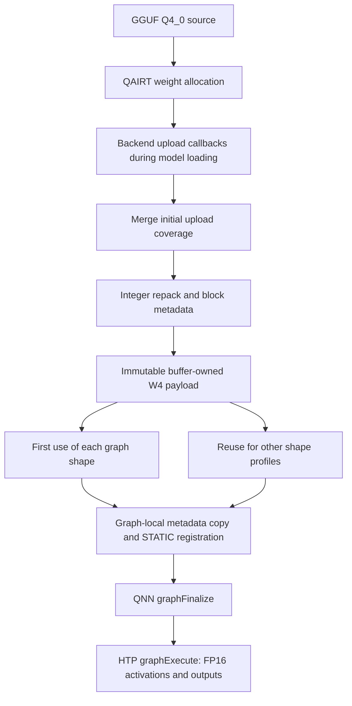

# QAIRT runtime W4FP16 weights

Implementation date: November 19, 2026. The existing full-FP16 path remains the default.

## Configuration

Set the environment before backend discovery or model loading:

```powershell
$env:GGML_QAIRT_DEVICE = 'HTP'
$env:GGML_QAIRT_W4FP16 = '1'
$env:GGML_QAIRT_LIBRARY_DIR = 'C:\Qualcomm\AIStack\QAIRT\2.52.0.261104\lib\aarch64-windows-msvc'
$env:ADSP_LIBRARY_PATH = 'C:\Qualcomm\AIStack\QAIRT\2.52.0.261104\lib\hexagon-v73\unsigned'
$env:PATH = $env:GGML_QAIRT_LIBRARY_DIR + ';' + $env:PATH
```

`GGML_QAIRT_W4FP16` accepts only `0` or `1`; default `0`. Configuration is captured once per process. Enabling it requires HTP and a discovered HTP architecture of V69 or newer. GPU/CPU execution policies remain disabled. Changing the environment after capture does not change an existing backend.

## Scope and tensor contract

The native path applies to admitted `GGML_OP_MUL_MAT` projections with contiguous, two-dimensional Q4_0 weights owned by QAIRT WEIGHTS buffers. The current backend emits QNN MatMul; research support for FullyConnected or Conv2d does not add production lowering for those operations.

| Tensor | QNN representation | Shape / metadata |
|---|---|---|
| Projection weights | STATIC `QNN_DATATYPE_SFIXED_POINT_8`, one signed code per byte | `[1,1,N,K]`; `BW_FLOAT_BLOCK`, bitwidth 4; blocks `[1,1,1,32]` |
| Block metadata | FP32 scale and FP32 offset per 32 codes | Positive scale; canonical offset 0 or 1 |
| Activation | FP16 | Reshape to `[1,1,M,K]` |
| MatMul output | FP16 | `[1,1,M,N]`, reshape to the GGML logical shape |
| Other numerical operations and weights | Existing FP16 path | Unchanged admission rules |
| Indices and control tensors | Existing SDK-required integer types | Unchanged narrowing and validation |

`transpose_in0=false`, `transpose_in1=true`. The byte carrier stores four-bit values sign-extended to eight bits; it is not packed QNN SFIXED_POINT_4 and is not activation quantization. QNN handles its internal packing and expansion into FP16. Raw GGUF Q4_0 bytes cannot be passed directly to this public tensor contract.

Other source formats, CPU-owned/untracked weights, incomplete uploads and unavailable prepared payloads retain the existing FP16 lowering. Malformed values can still fail FP16 numerical validation. A QNN preparation/execution error is reported through existing backend error handling; there is no silent retry with a different graph.

## Initialization and ownership

With the flag enabled, QAIRT buffers report `is_host=false`, although their storage is physically CPU-addressable. This ensures llama.cpp uploads weights through backend callbacks, including non-mmap loading. Otherwise, its host-buffer loader writes directly to storage and bypasses preparation. The backend explicitly accepts its own buffers and compatible host inputs; CPU consumers use normal GGML transfers. Flag-disabled buffers retain their existing host contract.

`buffer_set` and `buffer_memset` preserve the original GGML representation and notify the buffer-owned preparation cache. An eligible weight becomes ready only after upload ranges cover its entire source payload. Out-of-order chunks are merged; initial preparation runs once after full coverage. There are at most 128 tracked disjoint ranges per initial upload.

`w4_weight_upload` holds an immutable `w4_weights` payload containing signed byte codes and block metadata. Allocation-relative tensor addresses identify entries; width and row count are checked before reuse. Buffer mutexes protect cache access. Overlapping writes through aliases invalidate affected entries. Once the source is fully initialized, subsequent partial writes rebuild the affected weight eagerly during the write callback. Existing readers retain their previous immutable payload. Buffer clear removes sidecars; reset changes preparation generation without changing source bytes or dropping valid sidecars. Buffer destruction releases the cache.

Repacking expands integer nibbles and remaps their signs. It converts only one FP16 block delta to FP32 per 32 values; it does not generate a host FP16 weight matrix. Zero, negative and positive deltas are handled explicitly, and nonfinite scales or weights exceeding the FP16 range are rejected.

For a stored nibble `u` and Q4_0 delta `d`, the source value is `d*(u-8)`:

| Delta | Signed code | Scale | Canonical offset |
|---|---|---|---|
| `d > 0` | `u-8` | `d` | 0 |
| `d < 0` | `7-u` | `abs(d)` | 1 |
| `d == 0` | 0 | 1 | 0 |

The tested SDK's expansion behaves as `(code+offset)*scale`. This observed behavior differs from the public header's physical-offset formula. The released tensor registration also mutates the supplied offset array. Each `tensor_record` therefore copies canonical metadata into its own mutable ABI arrays before registration. Graphs and shape profiles never share those mutable arrays.



```mermaid
sequenceDiagram
    participant L as Model loader
    participant B as QAIRT buffer/cache
    participant P as Partition builder
    participant Q as QNN/HTP
    L->>B: Allocate WEIGHTS buffer and upload Q4_0
    B->>B: Repack once when initial upload completes
    L->>P: First inference for a shape profile
    P->>B: Retrieve immutable prepared payload
    B-->>P: Signed codes and canonical block metadata
    P->>P: Copy metadata for this graph
    P->>Q: Register STATIC weights; add MatMul and reshapes
    P->>Q: graphFinalize
    P->>Q: graphExecute with FP16 activations
    Q-->>P: FP16 outputs
    L->>P: Repeated inference for the same profile
    P->>Q: Refresh boundaries; execute cached graph
```

Weight repacking is initialization work. Graph compilation still occurs on first use of a shape profile. Runtime execution does not unpack Q4_0 weights on the native branch. Structural cache keys include the runtime mode, recipe revision, shapes, types and tracked allocation identity/generation. Source mutations invalidate prepared graphs through existing generation checks.

## Memory and diagnostics

For `N*K` weights, canonical sidecar payload bytes are `N*K + (N*K/32)*8`: signed codes plus scale/offset pairs. For a 2048-by-2048 matrix this is 5,242,880 bytes, versus 8,388,608 bytes for an FP16 matrix. Original Q4_0 storage remains allocated. Graph-local metadata copies, QNN compiled weights, compiler scratch, graph caches and driver memory are additional. This is not zero-copy loading or a total-memory guarantee.

`GGML_QAIRT_DIAGNOSTICS=1` reports initialization names, dimensions, payload bytes and repack count; connected-graph diagnostics include the native W4 projection count. `ggml_backend_qairt_stats.w4_preparations` counts native projection nodes in successfully finalized graphs. `w4_executions` counts native projection nodes in successfully executed graphs. These counters are not host repack counters. A projection reused by three finalized shape profiles contributes three preparations while retaining one upload-time canonical payload.

## Verification and limitations

The Windows ARM64 Release build passes. All 19 QAIRT CTests pass, including the native W4FP16 fixture. The native fixture checks out-of-order uploads, repeated execution, shape-profile reuse with private metadata, partial weight mutation, preserved source bytes and unchanged `1e-5` NMSE limits. It also checks the non-host buffer contract required by normal model loading.

Earlier research found 48 real-weight operation comparisons and four sign-extension verification cases passing; some dense synthetic distributions exceeded the same numerical budget. Native expansion is not generally bit-identical to host-decoded FP16 weights. Earlier timing measurements showed slower native execution and substantially slower finalization for some projections. This flag enables experimentation; it does not promise a speedup or universal accuracy qualification.

See `QAIRT-quantized-weights.md` for the SDK/source research, per-operation alternatives, rejected tensor contracts and measured numerical/performance limits. Model qualification results are recorded separately below.

## Qwen3 connected-block validation

The released SDK 2.52.0.261104 on HTP V73 was tested with `C:\Models\Qwen3-1.7B-Q4_0.gguf`. Blocks 0�26 ran on CPU; block 27 and final normalization used the existing fused hybrid fixture. The reference was its FP16-emulated CPU path. The prompt was `Name three planets in our solar system. /no_think`, with prefill 128, tail 13, 20 decode tokens and a reset replay.

All seven block-27 Q4_0 projections logged exactly one initialization repack before inference. Three shape profiles finalized 21 native MatMul instances; 23 fixture frames executed 161 native projection instances. Decode frames reused finalized graphs. This proves native W4 selection and initialization preparation in ordinary model loading, not merely in manually uploaded operator tests.

| Measurement | W4FP16 result |
|---|---|
| Greedy disagreement across 20 decode tokens | 0 |
| Maximum local projection NMSE | 6.12788406e-6; below unchanged 1e-5 budget |
| Maximum final-logit absolute error | 0.218582153 |
| Maximum final-logit KL | 7.46442405e-5 |
| Intermediate assertion failures | 41, all reported checkpoint failures |
| Model fixture exit | 1 |

The same one-block prompt/configuration on the FP16 path produced 22 intermediate failures and zero greedy disagreements. W4FP16 therefore increased intermediate failures in this run. For example, decode2 final residual `l_out-27` reached max absolute error 3 and NMSE 5.05366409e-6; decode2 FFN down output reached max absolute error 2 and NMSE 3.04193238e-6. The existing absolute-error checks remain unchanged. Passing local NMSE and greedy comparisons does not turn the full model fixture into a pass.

Full-model W4FP16 execution has now been tested as recorded below; strict numerical qualification and controlled performance profiling remain incomplete. The prior all-block FP16 qualification does not establish all-block W4 accuracy. Raw output was processed live; structured results are saved as `QAIRT_W4FP16_model_validation.json` in the integration documentation directory.

## Full-model run on November 20, 2026

All 28 Qwen3 blocks completed the fused hybrid fixture with 193 native W4 projections per frame (79.714% of model parameters). Each eligible weight repacked once during initialization. All 20 token comparisons matched the FP16-emulated reference, and reset equality checks reported no failures.

Strict accuracy gates failed: worst local projection NMSE 2.01044458e-5 versus 1e-5, and worst final-logit KL 0.00402100256 versus 0.001. Four decode frames exceeded local NMSE and two exceeded KL. Worst final-logit absolute error was 0.480585575, within 0.75. The fixture reported 2,022 failed assertions and exited 1; the prior FP16 baseline reported 1,948 failures and also exited 1. Both include the same 66 missing observation checks. No thresholds changed.

The run took 2,553.22 seconds and finalized 638 graphs, with 4,246 native projection preparations/executions. Its 1 GiB static graph-cache budget caused repeated compilation; initialization sidecars were reused. This validation timing is not a throughput benchmark.

The model fixture was corrected to retain CPU buffer ownership for its three unsupported Q4_1 projections before applying HTP overrides. Full results and capture limitations are documented in `QAIRT_W4FP16_full_model_results.md` in the integration documentation directory; structured measurements are in `QAIRT_W4FP16_all_blocks_validation.json`.

## Graph-cache budget and compilation timing

The backend's current logical static graph-cache budget is 4 GiB, with a separate limit of 512 cached entries. This budget accounts for retained `prepared_run::static_bytes`; it does not bound all compiled QNN allocations, driver mappings, compiler scratch or total process memory. A laptop's physical RAM capacity does not guarantee that HTP can map every retained graph's weights.

The first all-block W4FP16 run with this budget completed prefill, then failed during first-decode graph finalization. SDK diagnostics reported a weights-buffer mapping failure on NSP followed by QNN error 1002 (`QNN_GRAPH_ERROR_MEM_ALLOC`). This result does not establish the exact HTP mapping limit. The earlier 1 GiB run completed all frames with its documented numerical exceptions.

`ggml_backend_qairt_stats` reports successful preparations, cache hits, executions and failed finalizations. `preparation_time_us` covers graph/context creation, lowering, tensor/node registration and finalization for attempts that reach finalization. `finalization_time_us` measures `graph_owner::finalize()`, including `api.graphFinalize`, for successful and failed calls. Finalization time is included in preparation time; do not add the totals. Cache hits add no preparation or finalization time. The model fixture prints graph statistics on aborted decode as well as completed frames.

Detailed 4 GiB results are in `QAIRT_W4FP16_cache4GiB_full_model_results.md` and `QAIRT_W4FP16_cache4GiB_full_model_validation.json` in the integration documentation directory. The first aborted capture is preserved separately as `QAIRT_W4FP16_cache4GiB_initial_abort.json`; it lacks first-decode timing because its fixture returned before printing that frame's counters.